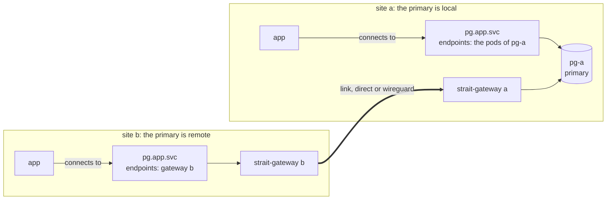
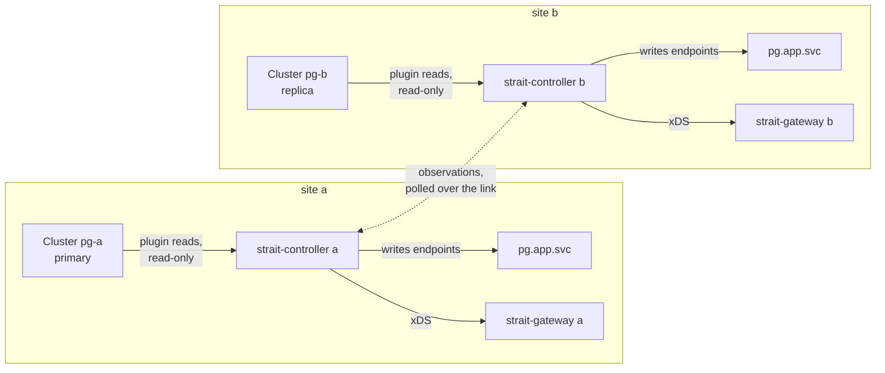

# Strait

Strait gives an application one stable local name per dependency, at every site, and points that name at the member that is active now. A site is one Kubernetes cluster. The member can run at the same site or at another one, and Strait carries the TCP traffic between sites.

The application holds no topology: no host lists, no address maps, no failover logic. It connects to `pg.app.svc:5432` at every site. When the PostgreSQL primary moves to another site, the name follows.

Strait routes. It never fails over, promotes or demotes a workload. The workload's own controller, such as CloudNativePG, or the operator moves the primary, and Strait follows.

## How it works

The same `SiteService`, named `pg`, is applied at both sites. Each site decides its own route. A connection to `pg.app.svc` takes this path:



- At site a, the primary `pg-a` is local. `pg.app.svc` points at its pods.
- At site b, the primary is remote. `pg.app.svc` points at gateway b, which carries each connection over the link to gateway a, and on to `pg-a`.

The route comes from the controller at each site:



Each controller reads only the members at its own site. It polls the other site's observations through the gateways, over the same link.

| Piece | Runs as | Does |
|---|---|---|
| Application name | A Service named after the `SiteService`, with no selector | The name the application connects to. Strait writes its endpoints: the member's pods, the local gateway, or nothing. |
| `strait-controller` | Deployment, one per site | Runs the plugins on local members, reads the peers' observations, decides the route, writes the endpoints, and configures the gateway over xDS. |
| Plugin | Inside the controller | Reads a workload's state, read-only: `cnpg` or `declared`. |
| Observation exchange | HTTP `GET` over the link | Each site publishes what it observes about its own members, and each peer polls it. No site holds credentials to another site's API. |
| `strait-gateway` | Deployment per site, one active replica | Envoy carries TCP between sites. An agent next to it holds the WireGuard interfaces and reports link health. |
| Link | One `SiteLink` per path to a peer | A transport, `direct` or `wireguard`, and a cost. The healthy link with the lowest cost carries the traffic. |
| `strait` | CLI on the operator's machine | Shows and explains the state of one site. Read-only. |

Each site has one `Site`, one `SitePeer` per peer and one `SiteLink` per path. All resources are listed in [RFC0001](rfcs/RFC0001.md#resources).

## Properties

| Property | Means | Design |
|---|---|---|
| Routes nowhere rather than to a guess | When Strait cannot tell which member is active, the name has no endpoints. A new connection is refused at once, and the client retries. The name routes nowhere when two members are writable, when sites declare different primaries, or when a member stays Unknown for too long. | [RFC0002](rfcs/RFC0002.md) |
| Observes, never acts on a workload | Plugins get read-only permissions and no workload credentials. Strait never promotes, demotes, fences or reconfigures a workload. | [RFC0003](rfcs/RFC0003.md), [RFC0007](rfcs/RFC0007.md) |
| Modes `Single` and `Set` | `Single` routes to the one writable member, such as a database primary. `Set` routes to every eligible member, such as read replicas, filtered by locality: `LocalFirst`, `LocalOnly` or `Any`. | [RFC0002](rfcs/RFC0002.md) |
| Plugins `cnpg` and `declared` | `cnpg` reads CloudNativePG `Cluster`s, and a `Pooler` when named. `declared` takes the active member from the spec, for a workload that no plugin observes. | [RFC0003](rfcs/RFC0003.md) |
| Transports `direct` and `wireguard` | `direct` is a private path with no tunnel, declared `encryption: None`. `wireguard` is a kernel WireGuard tunnel between the gateways. When the active link fails, new connections move to the next one within 5 seconds. | [RFC0005](rfcs/RFC0005.md) |
| Endpoint-direct | On a `direct` link where pod addresses are routable between sites, the name points straight at the remote pods, with no gateway hop. In production, set the link's `endpointCIDRs` to the peer's pod CIDRs, so that a peer's document cannot point the name at another address. | [RFC0005](rfcs/RFC0005.md), [benchmark](docs/benchmark.md) |
| Envoy over xDS | The controller configures Envoy with no reload. A route change never closes an established connection. | [RFC0005](rfcs/RFC0005.md) |
| Read-only CLI with an AI agent skill | `strait` explains why a name points where it does. `strait --skill` prints a skill document for AI agents. | [RFC0006](rfcs/RFC0006.md) |

## Example

`strait explain` at site b, while the primary runs at site a:

```
$ strait --context site-b explain pg -n app
SiteService:  app/pg
Mode:         Single
Plugin:       cnpg, role primary
Policy:       multiple RouteNowhere, unknownHold 30s
Route:        pg-a
Reason:       Active
Meaning:      Single mode. Exactly one member is writable, and no known site declares another. The name points at it.
Message:      pg-a is the only writable member
Since:        2026-10-27T09:48:00Z (12m ago)
Endpoints:    1

Members:
NAME  SITE  ROUTED  PATH     ROLE     ELIGIBLE  STATE   REASON          OBSERVED  CONFIRMED
pg-a  a     true    Gateway  primary  true      Stable  PrimaryCluster  1s        1s
pg-b  b     false   -        replica  false     Stable  ReplicaCluster  1s        -

Declarations:
SITE  PRIMARY
a     pg-a
b     pg-a

Conditions:
TYPE                  STATUS  REASON                  SINCE  MESSAGE
Routed                True    Active                  12m    pg-a is the only writable member
Multiple              False   NoMultipleWritable      12m    -
DeclarationsDisagree  False   NoDeclarationsDisagree  12m    -
Held                  False   NoHeldUnknown           12m    -
Applied               True    Synced                  12m    -
DeclarationUnmatched  False   NoDeclarationUnmatched  12m    -
```

## Status

| Item | Value |
|---|---|
| Release | v1.3.2 |
| API | `strait.tako.id/v1`. `v1alpha1` is still served, deprecated. A change that breaks a user comes as a new API version. |

## Quick start

`make e2e` builds two sites on kind, with CloudNativePG in its distributed topology, and runs every scenario: link failover, switchover, a partition, disagreeing declarations, site loss, and two writable members.

```sh
make e2e
```

It builds the image, creates the kind clusters `strait-e2e-a` and `strait-e2e-b`, runs the scenarios, and deletes the clusters. To keep them and look around:

```sh
STRAIT_E2E_KEEP=1 make e2e
make build
bin/strait --kubeconfig <kubeconfig of site b> --context kind-strait-e2e-b -n db explain pg
```

The test prints where it wrote the kubeconfigs. The prerequisites, the fixture and the scenarios are in [`test/e2e/README.md`](test/e2e/README.md).

## Install

Each release publishes:

| Artifact | Where |
|---|---|
| Helm chart | `oci://ghcr.io/takodotid/charts/strait` |
| Image, linux/amd64 and linux/arm64 | `ghcr.io/takodotid/strait` |
| CLI archives for Linux, macOS and Windows, amd64 and arm64, with `SHA256SUMS` | [GitHub releases](https://github.com/takodotid/strait/releases) |
| The CRDs, in one file: `strait-crds.yaml` | [GitHub releases](https://github.com/takodotid/strait/releases) |

Each site needs Kubernetes 1.31 or later. The CRDs' validation rules use the CEL functions `isIP` and `isCIDR`. The API server of 1.30 or earlier refuses these CRDs. `make test` runs the CRDs' rules on the oldest and the latest version, which the `Makefile`'s `ENVTEST_K8S_VERSIONS` names.

Install the chart at each site, in a namespace with the Pod Security level `privileged`, with the values of [Getting started](docs/getting-started.md#2-install-the-chart):

```sh
helm --kube-context site-a install strait oci://ghcr.io/takodotid/charts/strait --version 1.3.2 \
  --namespace strait-system --values values-a.yaml --wait
```

Before a site serves production traffic, go through [Before production](docs/runbooks/before-production.md). Every value of the chart is in [`values.yaml`](deploy/helm/strait/values.yaml). [Getting started](docs/getting-started.md) sets up two clusters step by step, from the WireGuard key to a routed name. The controller's memory grows with the number of Services in the cluster: see [Sizing](docs/sizing.md).

Install the CLI, here for Linux on amd64:

```sh
v=v1.3.2
curl -fsSLO "https://github.com/takodotid/strait/releases/download/$v/strait_${v}_linux_amd64.tar.gz"
curl -fsSLO "https://github.com/takodotid/strait/releases/download/$v/SHA256SUMS"
sha256sum --ignore-missing -c SHA256SUMS
tar -xzf "strait_${v}_linux_amd64.tar.gz"
sudo install "strait_${v}_linux_amd64/strait" "strait_${v}_linux_amd64/kubectl-strait" /usr/local/bin/
```

The archive also holds the man pages in `man/man1/` and the skill document `SKILL.md`.

### Verify a release

From 1.3.0, each release signs the image and the chart with Sigstore. The signing is keyless and uses the identity of the release's workflow. It attests the CLI archives, the chart archive, `strait-crds.yaml` and `SHA256SUMS` with GitHub artifact attestations. The chart records the digest of the image's index in the annotation `strait.tako.id/image-digest` ([RFC0007, Releases](rfcs/RFC0007.md#releases)). From 1.5.0, the index lists only the platform images, `linux/amd64` and `linux/arm64`. Each platform image carries its build's provenance (SLSA v1) and its SBOM (SPDX) as cosign attestations under the same identity.

Verify the chart and its image with [cosign](https://docs.sigstore.dev/cosign/verifying/verify/) 3, and an archive with the GitHub CLI's `gh attestation verify`:

```sh
v=v1.3.2
id="https://github.com/takodotid/strait/.github/workflows/release.yaml@refs/tags/$v"
issuer=https://token.actions.githubusercontent.com
cosign verify "ghcr.io/takodotid/charts/strait:${v#v}" --certificate-identity "$id" --certificate-oidc-issuer "$issuer"
digest=$(helm show chart oci://ghcr.io/takodotid/charts/strait --version "${v#v}" | sed -n 's|^  strait.tako.id/image-digest: ||p')
cosign verify "ghcr.io/takodotid/strait@$digest" --certificate-identity "$id" --certificate-oidc-issuer "$issuer"
gh attestation verify "strait_${v}_linux_amd64.tar.gz" --repo takodotid/strait --cert-identity "$id"
gh attestation verify SHA256SUMS --repo takodotid/strait --cert-identity "$id"
```

From 1.5.0, verify each platform image's provenance and SBOM. This needs `docker` and `jq` too. The platform images come from the index that the chart names:

```sh
for image in $(docker buildx imagetools inspect "ghcr.io/takodotid/strait@$digest" --raw | jq -r '.manifests[].digest'); do
  cosign verify-attestation "ghcr.io/takodotid/strait@$image" --type slsaprovenance1 --certificate-identity "$id" --certificate-oidc-issuer "$issuer" >"provenance-${image#sha256:}.json"
  cosign verify-attestation "ghcr.io/takodotid/strait@$image" --type spdxjson --certificate-identity "$id" --certificate-oidc-issuer "$issuer" >"sbom-${image#sha256:}.json"
done
```

Each file holds the attestation as a DSSE envelope. `jq '.payload | @base64d | fromjson | .predicate' FILE` prints the provenance or the SBOM.

To rebuild a CLI archive or the image from the release's tag and compare it with what the release published, see [Rebuild a release](docs/runbooks/rebuild.md).

| Value | Effect on the image |
|---|---|
| `image.tag` and `image.digest` empty | The image that the chart's release pushed: `ghcr.io/takodotid/strait:X.Y.Z@sha256:...`. |
| `image.tag` set | That tag, without a digest, as before 1.3.0. |
| `image.digest` set | That digest. |
| `image.repository` set, for a mirror | The mirror, with the release's digest while `image.tag` and `image.digest` are empty. Copy the image with its digest, for example with `crane copy` or `skopeo copy --all`. |

### CLI on Windows

The Windows archive is a `.zip` with `strait.exe` and `kubectl-strait.exe`. Install it in PowerShell, here on amd64:

```powershell
$v = "v1.3.2"
$a = "strait_${v}_windows_amd64"
$url = "https://github.com/takodotid/strait/releases/download/$v"
Invoke-WebRequest "$url/$a.zip" -OutFile "$a.zip" -UseBasicParsing
Invoke-WebRequest "$url/SHA256SUMS" -OutFile SHA256SUMS -UseBasicParsing
$sum = (Get-Content SHA256SUMS | Where-Object { $_.EndsWith("  $a.zip") }).Split(" ")[0]
if ((Get-FileHash "$a.zip" -Algorithm SHA256).Hash -ne $sum) { throw "$a.zip does not match SHA256SUMS" }
Expand-Archive "$a.zip" -DestinationPath .
$bin = "$env:LOCALAPPDATA\Programs\strait"
New-Item -ItemType Directory -Force $bin | Out-Null
Copy-Item "$a\strait.exe", "$a\kubectl-strait.exe" $bin
```

Add that folder to `Path` once, then open a new terminal. kubectl finds `kubectl-strait.exe` there, so `kubectl strait` runs the same commands. Flags go after `strait`:

```powershell
strait version
kubectl plugin list
kubectl strait --context site-a status
```

| Difference on Windows | Detail |
|---|---|
| Exit status of `kubectl strait` | 1 on every failure, and kubectl adds the line `Error: exit status N`, because on Windows kubectl runs a plugin as a child process. `strait.exe` exits with 0, 1 or 2 as on other systems. |
| Man pages | Windows has no `man`. `strait --help` and `strait COMMAND --help` hold the same text. |
| Skill document | Copy `SKILL.md` from the archive into `<skills dir>\strait\`. In Windows PowerShell 5.1, `strait --skill > SKILL.md` writes UTF-16LE, not the UTF-8 that `strait` prints. |

### Upgrade

Upgrade one site at a time. Sites on different 1.x releases still read each other's observations. To go back to an earlier release: [Roll back within 1.x](docs/runbooks/rollback.md).

| Step | What to do |
|---|---|
| 1. Pull the images | Required when a pull can take longer than the site's budget, below. List the release's images with `helm template`, as below. Pull each one on every node of the site, for example with `crictl pull`. From 1.3.0, the chart's pre-pull Job also runs the release's image on the controller's node before the upgrade changes anything (`controller.prePull`), but the new controller pod can start on another node. |
| 2. Upgrade the site | Apply the release's CRDs first, then upgrade the chart with the same values, as below. Helm installs the chart's CRDs on the first install only, and never upgrades or deletes them. From a release before 1.2.0, the new CRDs add `SiteLink.spec.direct.endpointCIDRs`, which the API server does not know until the new CRDs are applied. From a release before 1.3.0, they add `Site.spec.gateway.lease`. From a release before 1.4.0, they refuse a `Site` whose gateway ports include 8090, 8091 or 9901, where the gateway agent and Envoy's admin interface listen. Change such a port first. On Kubernetes 1.31 and 1.32, under the new CRDs, every write to the status of a `Site` stored with such a port is refused. The controller then stops updating that status, including the active gateway's address. This was seen on envtest's API server, 1.31.0 to 1.37.0, and from 1.33 the status write passes ([RFC0005](rfcs/RFC0005.md#requirements), requirement 52). From a release before 1.5.0, with `networkPolicy.gateway.enabled`, the gateway's policy lets the cluster's pods reach the import and export ports only, and lets the controller reach the peer port. A pod that connects to another gateway port, such as the control port, is refused. The CIDRs in `networkPolicy.gateway.peerCIDRs` can reach only these: the control and export ports, and the UDP ports in the new value `networkPolicy.gateway.wireGuardPorts`. List the site's WireGuard listen ports there, or `[]` when the site has no `wireguard` link. With `site.create: false`, set `networkPolicy.gateway.ports` too. Without them, `helm upgrade` fails ([RFC0007](rfcs/RFC0007.md#network-policies), requirement 28). From a release before 1.5.0, the image's index lists the platform images only, and each platform image carries its provenance and SBOM as cosign attestations. The verify commands of 1.4.0 still pass: `cosign verify` of the chart and the image, and `gh attestation verify` of an archive. `docker buildx imagetools inspect --format '{{json .Provenance}}'` and `'{{json .SBOM}}'` read attestations from the index, so they print `{}`. Read the attestations with `cosign verify-attestation` ([Verify a release](#verify-a-release)). From a release before 1.5.0, the gateway agent uses nftables to filter the traffic that arrives on its WireGuard interfaces. On a node whose kernel lacks `nf_tables`, once the gateway rolls, each `wireguard` link has no interface and shows `NotConfigured`. Check the nodes that can run a gateway pod first ([RFC0005](rfcs/RFC0005.md#wireguard)). |
| 3. Wait | Run `strait --context SITE status -A` at every site. Go on once each shows every peer `REACHABLE`, and every name with the route and reason it had before the upgrade, usually `Active`. |
| 4. Next site | Back to step 1. |

```sh
v=v1.3.2
helm template strait oci://ghcr.io/takodotid/charts/strait --version "${v#v}" --values values-a.yaml | grep 'image:' | sort -u
curl -fsSLO "https://github.com/takodotid/strait/releases/download/$v/strait-crds.yaml"
kubectl --context site-a apply --server-side --force-conflicts -f strait-crds.yaml
helm --kube-context site-a upgrade strait oci://ghcr.io/takodotid/charts/strait --version "${v#v}" \
  --namespace strait-system --values values-a.yaml --wait
```

When the release's image cannot be pulled or run, the pre-pull Job fails, and `helm upgrade` fails with `pre-upgrade hooks failed` on `Job/strait-system/strait-pre-pull`. Nothing else has changed, and the old controller still runs. Read why with `kubectl --context site-a -n strait-system describe pod -l app.kubernetes.io/component=pre-pull`. The failed Job stays until the next upgrade replaces it.

What the site shows during an upgrade:

| Part | What happens | What the operator sees |
|---|---|---|
| Controller | One replica with the `Recreate` strategy ([RFC0004](rfcs/RFC0004.md#requirements), requirement 12). The site has no controller from the moment its old pod stops until its new pod serves. That gap includes the image pull, the start, and the wait for the leader election Lease. There is no wait when the old controller released the Lease as it stopped, and a 15s wait when it did not ([RFC0004](rfcs/RFC0004.md#leader-election)). A controller of 1.1.3 or later releases it. | At the other sites, once the gap passes `peerTimeout` (6s by default), the site's peer is not `REACHABLE`, and its members are `Unknown`. A routed `Unknown` member stays in the route, with reason `HeldUnknown`, for `policy.unknownHold` (30s by default) after it was last confirmed. Then the name routes nowhere with `UnknownTimeout` until the new controller serves ([RFC0002](rfcs/RFC0002.md#requirements), requirement 17). At the site itself, its names keep the endpoints written last, and their status does not change. Then their status shows `AwaitingPeers` until the new controller's first poll of every peer has ended. |
| Gateway | Every release rolls the gateway, because its agent runs the release's image. With the chart's 2 replicas, the Deployment starts one new pod, and stops an old pod once the new one is ready, until no old pod is left. The active pod has a deletion cost, so it stops last ([RFC0005, Gateway rollout](rfcs/RFC0005.md#gateway-rollout)). When it stops, its agent removes its WireGuard interfaces and releases the gateway Lease, and a new replica takes it ([RFC0005, Failover sequence](rfcs/RFC0005.md#failover-sequence)). The Lease moves once. From a release before 1.3.0, it can move twice, because the active pod has no deletion cost until the new controller sets it. | Each move resets every connection through the site's gateway, in both directions: this site's clients of remote members, and the other sites' clients of this site's members. Connections to a local member, and endpoint-direct connections, do not cross the gateway. New connections through the gateway fail until the new active pod's links pass their health checks. The polls between the site and its peers cross the gateway too. When a move lasts longer than `peerTimeout`, each side counts the other's members as `Unknown`, as in the controller row. `strait status` shows the new active gateway pod. |

How to plan:

| Plan | Why |
|---|---|
| Keep the controller gap under the smallest `policy.unknownHold` of the names with a member at the site. | Past that, those names route nowhere at the other sites until the new controller serves. |
| Pull the images first (step 1) when a pull can take longer than that budget, minus the start and the Lease wait. | The pull is part of the gap. |
| Upgrade while the clients of names that cross the gateway can reconnect. | Each move of the gateway Lease resets their connections. |
| Move no primary at any site while a site upgrades. | During the gap, the site's names keep the endpoints written last, and the other sites cannot read what the site declares. |
| One site at a time. | Only that site's members are at risk, and step 3 shows the upgrade worked before the next site. Every site at once puts every site's members at risk together. |

#### Node drains

A drain moves Strait's pods off a node. The chart's PodDisruptionBudget lets a drain evict one gateway pod at a time. A gateway pod that is not ready can be evicted at any time (`gateway.podDisruptionBudget`). The controller has no budget, because it runs one replica, and a budget would block every drain of its node.

| The drained node runs | Effect |
|---|---|
| The controller | The controller gap, as in an upgrade. The new pod pulls its image on its new node, unless step 1 of the upgrade pulled it there. |
| The active gateway pod | One move of the gateway Lease, as in an upgrade. |
| A standby gateway pod | None. |

With `gateway.antiAffinity: required`, each gateway replica runs on a node of its own, so one drain never takes two. A rollout then needs one node more than `gateway.replicas`, for the new pod it starts first. With the default, `preferred`, two replicas can share a node when no other node fits.

Drain the nodes of one site at a time, and plan each drain as an upgrade. After a node that ran the controller or the active gateway pod, wait as in step 3 before the next node. `kubectl --context site-a -n strait-system get pods -o wide` shows each pod's node, and `strait --context site-a status` shows the active gateway pod.

#### From 0.1 to 1.0

1.0 serves the API as `strait.tako.id/v1`. It still serves `strait.tako.id/v1alpha1`, deprecated, with the same schema ([RFC0001](rfcs/RFC0001.md#api-versions)).

| Step | What to do |
|---|---|
| 1. Upgrade each site | As above. Objects that 0.1 stored keep working and keep their identity. |
| 2. Move your manifests | Change `apiVersion: strait.tako.id/v1alpha1` to `strait.tako.id/v1`. Nothing else changes. `strait validate` warns about each object that still names `v1alpha1`, and `kubectl` prints a deprecation warning. |
| 3. Store every object as `v1` | Needed before a release that stops serving `v1alpha1`. Run the commands below at each site. |

```sh
ctx=site-a
for r in sites sitepeers sitelinks exports imports siteservices; do
  kubectl --context "$ctx" get "$r.strait.tako.id" --all-namespaces -o json | kubectl --context "$ctx" replace -f -
done
for r in sites sitepeers sitelinks exports imports siteservices; do
  kubectl --context "$ctx" patch crd "$r.strait.tako.id" --subresource=status --type=merge \
    -p '{"status":{"storedVersions":["v1"]}}'
done
```

`replace` writes each object again, in the version that the API server stores, which is `v1`. If it reports a conflict, the controller changed that object in the meantime. Run the first loop again. Run the second loop only once the first has replaced every object.

The 1.0 CLI reads `v1`, so it needs a site whose CRDs are 1.0. With the 1.0 CRDs in place, `helm rollback` to 0.1 still works, since they serve `v1alpha1`.

## A `SiteService`

Apply the same object at every site:

```yaml
apiVersion: strait.tako.id/v1
kind: SiteService
metadata:
  name: pg
  namespace: app
spec:
  mode: Single
  port:
    name: postgres
    port: 5432
  plugin:
    cnpg:
      role: primary
  members:
    - name: pg-a
      site: a
      cnpg:
        cluster: pg-a
    - name: pg-b
      site: b
      cnpg:
        cluster: pg-b
  policy:
    unknownHold: 30s
```

Applications at both sites connect to `pg.app.svc:5432`. Each site's controller writes that Service's endpoints: the primary's pods when it is local, the local gateway when it is remote, and nothing when it cannot tell which member is writable.

## CLI

| Command | Shows |
|---|---|
| `strait status` | The site and its controller's version, its peers, and where every application name points. |
| `strait explain SITESERVICE` | Why one name points where it does: the reason, every member's observation, every site's declaration. |
| `strait links` | Every link to a peer, its health, and which link carries the traffic. |
| `strait peers` | Every peer, and whether its observations can be read. |
| `strait validate -f PATH` | Checks manifests offline, with the rules of the CRDs. |
| `strait --skill` | Prints the skill document for AI agents. |
| `strait version` | The CLI's version and commit. `strait --version` prints them on one line. |
| `strait completion SHELL` | The completion script for `bash`, `zsh`, `fish` or `powershell`. |

Each command that reads a cluster reads one site, so pass `--context` for each. Every command takes `-o json` or `-o yaml`. Installed as `kubectl-strait`, or `kubectl-strait.exe` on Windows, the same commands run as `kubectl strait`.

For an AI agent: `strait --skill > <skills dir>/strait/SKILL.md` installs a skill that explains how to read Strait's state.

### Shell completion

Completion covers commands, flags, the values of `-o`, the kubeconfig's contexts, and the names of namespaces and `SiteService`s. Names come from the context's cluster, within 2s. A completion never asks for credentials.

| Shell | Add |
|---|---|
| bash | `source <(strait completion bash)` in `~/.bashrc`. Needs the `bash-completion` package. |
| zsh | `source <(strait completion zsh)` in `~/.zshrc`, after `compinit`. |
| fish | `strait completion fish > ~/.config/fish/completions/strait.fish` |
| PowerShell | `strait completion powershell \| Out-String \| Invoke-Expression` in `$PROFILE`. |
| `kubectl strait` | A link named `kubectl_complete-strait` to the binary, on the `PATH`: `ln -s "$(command -v kubectl-strait)" ~/.local/bin/kubectl_complete-strait`. On Windows, a copy of `kubectl-strait.exe` named `kubectl_complete-strait.exe` next to it. kubectl 1.26 or later runs it to complete `kubectl strait`. |

## Documentation

| Document | Covers |
|---|---|
| [Getting started](docs/getting-started.md) | Two clusters, a WireGuard link, and a `SiteService` with the `cnpg` plugin. |
| [Troubleshooting](docs/troubleshooting.md) | A name routed nowhere, Unknown members, unreachable peers, unhealthy links. |
| [Metrics and alerts](docs/metrics.md) | Every metric, how to scrape it, the alert rules, and what the probes check. |
| [Failover time](docs/failover-time.md) | Strait's share of the time until writes work again: detection, holds, the workload's move, applying the route, what to tune, and when the route became `Active` again. |
| [Sizing](docs/sizing.md) | The controller's memory per Service of the cluster, its limit, and how to cache fewer objects. |
| [Runbooks](docs/troubleshooting.md#runbooks) | The checks before production, site loss and return, a partition that heals, adding or removing a site, WireGuard key rotation, a controller or a gateway that is not ready, a gateway handover, rollback, a release. |
| [Gateway benchmark](docs/benchmark.md) | What the gateway adds per round trip and per connection, and what endpoint-direct saves. |
| [End-to-end tests](test/e2e/README.md) | The kind fixture and its scenarios. |
| [RFC0001](rfcs/RFC0001.md) | Scope, glossary, resources and components. |
| [RFC0002](rfcs/RFC0002.md) | `SiteService`, modes, policies, and the decision table. |
| [RFC0003](rfcs/RFC0003.md) | The plugin contract, `cnpg` and `declared`. |
| [RFC0004](rfcs/RFC0004.md) | The observation exchange. |
| [RFC0005](rfcs/RFC0005.md) | The data plane: links, transports, the gateway, endpoint-direct. |
| [RFC0006](rfcs/RFC0006.md) | The CLI. |
| [RFC0007](rfcs/RFC0007.md) | Security: permissions, credentials, links, releases. |

`strait --help` and the man pages cover every command and flag.

## How this project is built

Strait is built with AI coding agents (Claude Code), and a person directs and approves the work.

**What the agents do:** write code, tests and docs, review each other's changes, and look for bugs and gaps.

**What a person decides:**
- **Design.** Every change starts as an RFC, and a maintainer approves each RFC and each change to one.
- **Scope.** A maintainer decides what goes into each round of work and what waits.
- **Merges and releases.** Only a maintainer merges a pull request. Releases come from tags signed by a maintainer, and a maintainer approves each release run.

**How the work is checked:**
- Each fix comes with a test that fails without the fix.
- CI runs the unit tests, the race detector, and end-to-end tests on kind for every pull request.
- Before a release, the change is tested on real clusters, not only in CI.
- Releases are signed, and you can verify every release asset (see [Verify a release](#verify-a-release)).

**Why we trust it in production:** we run Strait ourselves, for our own databases. A router that sends writes to the wrong database would hurt us first.

If you find a problem, open an issue. Saying that it looks AI-written is fine, as long as you say what's wrong.

## Contributing

Design decisions live in [`rfcs/`](rfcs/). Before changing a subject, read the RFC that covers it.

| Change | Process |
|---|---|
| Code that conforms to an Active RFC | A pull request. CI runs `make verify`, `make test`, `make build` and `make e2e` on it. |
| Code that departs from an RFC | Amend the RFC first, in the same pull request or an earlier one. When the code and an RFC disagree, the RFC wins. |
| A new subject | A new RFC with the status Draft. It becomes Active with the maintainers' approval, once its open questions are resolved. |
| A change that breaks a user of the API | A new API version. |

The rules, the RFC format, the writing style and the `make` targets: [AGENTS.md](AGENTS.md). Commits follow Conventional Commits, for example `docs(rfc0002): define the link resource`.

## License

Apache-2.0. See [LICENSE](LICENSE).
