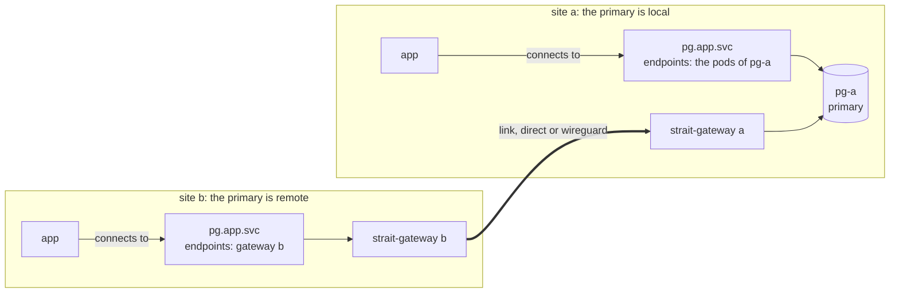

<h1 align="center">Strait</h1>

<p align="center"><b>One name per dependency, at every site.</b><br>Strait points each application's local name at the member that is active now, in its own Kubernetes cluster or another one, and carries the TCP traffic between them.</p>

<p align="center">
    <a href="https://github.com/takodotid/strait/actions/workflows/ci.yaml?query=branch%3Amain"></a>
    <a href="https://github.com/takodotid/strait/releases"></a>
    <a href="LICENSE"></a>
    <a href="https://strait.tako.id"></a>
</p>

<p align="center">
    <a href="https://strait.tako.id/guide/install">Install</a> ·
    <a href="https://strait.tako.id/guide/introduction">Guide</a> ·
    <a href="https://strait.tako.id/runbooks/before-production">Operations</a> ·
    <a href="https://strait.tako.id/reference/cli">Reference</a>
</p>

## What it does

- **One name at every site.** The application connects to `pg.app.svc:5432` everywhere. It holds no host lists, no address maps and no failover logic. When the PostgreSQL primary moves to another site, the name follows.
- **Routes, never acts.** Strait never fails over, promotes or demotes a workload. The workload's own controller, such as CloudNativePG, or the operator moves the primary, and Strait follows. Plugins read a workload's state with read-only permissions.
- **Routes nowhere rather than to a guess.** When Strait can't tell which member is active, the name has no endpoints. A new connection is refused at once, and the client retries.
- **Each site decides its own route.** A site is one Kubernetes cluster. Its controller reads its own members, and polls what the other sites observe over a `direct` private path or a `wireguard` tunnel between the gateways. When the active link fails, new connections move to the next one within 5 seconds.
- **A read-only CLI.** `strait explain` says why a name points where it does. `strait --skill` prints a skill document for AI agents.

## How it works



The same `SiteService` is applied at both sites:

```yaml
apiVersion: strait.tako.id/v1
kind: SiteService
metadata:
  name: pg
  namespace: app
spec:
  mode: Single
  port:
    name: postgres
    port: 5432
  plugin:
    cnpg:
      role: primary
  members:
    - name: pg-a
      site: a
      cnpg:
        cluster: pg-a
    - name: pg-b
      site: b
      cnpg:
        cluster: pg-b
  policy:
    unknownHold: 30s
```

Each site's controller writes the endpoints of `pg.app.svc`: the primary's pods when it is local, the local gateway when it is remote, and nothing when it can't tell which member is writable. [Concepts](https://strait.tako.id/guide/concepts) has the pieces, the modes, the plugins and the links.

## Install

Each site needs Kubernetes 1.31 or later. Install the chart at each site:

```sh
helm --kube-context site-a install strait oci://ghcr.io/takodotid/charts/strait --version 1.5.0 \
  --namespace strait-system --values values-a.yaml --wait
```

Then install the `strait` CLI from the [release archives](https://github.com/takodotid/strait/releases). [Install](https://strait.tako.id/guide/install) has the CLI on Linux, macOS and Windows, and how to verify a release. [Getting started](https://strait.tako.id/getting-started) sets up two clusters step by step, from the WireGuard key to a routed name.

## Commands

| Command | Shows |
|---|---|
| `strait status` | The site, its peers, and where every application name points. |
| `strait explain SITESERVICE` | Why one name points where it does. |
| `strait links` | Every link to a peer, its health, and which link carries the traffic. |
| `strait peers` | Every peer, and whether its observations can be read. |
| `strait validate -f PATH` | Checks manifests offline, with the rules of the CRDs. |

Each command reads one site: pass `--context`. Installed as `kubectl-strait`, the same commands run as `kubectl strait`. Every command and flag: [The strait command](https://strait.tako.id/reference/cli).

## Docs

The [documentation site](https://strait.tako.id), whose pages are in [`docs/`](docs/): the [guide](https://strait.tako.id/guide/introduction), the [operations runbooks](https://strait.tako.id/runbooks/before-production), the [reference](https://strait.tako.id/reference/cli) and the [limitations](https://strait.tako.id/limitations). Design decisions live in the [RFCs](rfcs/), which every change follows.

## How this project is built

Strait is built with AI coding agents (Claude Code), and a person directs and approves the work.

**What the agents do:** write code, tests and docs, review each other's changes, and look for bugs and gaps.

**What a person decides:**
- **Design.** Every change starts as an RFC, and a maintainer approves each RFC and each change to one.
- **Scope.** A maintainer decides what goes into each round of work and what waits.
- **Merges and releases.** Only a maintainer merges a pull request. Releases come from tags signed by a maintainer, and a maintainer approves each release run.

**How the work is checked:**
- Each fix comes with a test that fails without the fix.
- CI runs the unit tests, the race detector, and end-to-end tests on kind for every pull request.
- Before a release, the change is tested on real clusters, not only in CI.
- Releases are signed, and you can verify every release asset (see [Verify a release](https://strait.tako.id/guide/install#verify-a-release)).

**Why we trust it in production:** we run Strait ourselves, for our own databases. A router that sends writes to the wrong database would hurt us first.

If you find a problem, open an issue. Saying that it looks AI-written is fine, as long as you say what's wrong.

## Contributing

Design decisions live in [`rfcs/`](rfcs/). Before changing a subject, read the RFC that covers it.

| Change | Process |
|---|---|
| Code that conforms to an Active RFC | A pull request. CI runs `make verify`, `make test`, `make test-race`, `make lint`, `make test-envoy`, `make test-netns`, `make build` and `make e2e` on it, and builds the docs site. |
| Code that departs from an RFC | Amend the RFC first, in the same pull request or an earlier one. When the code and an RFC disagree, the RFC wins. |
| A new subject | A new RFC with the status Draft. It becomes Active with the maintainers' approval, once its open questions are resolved. |
| A change that breaks a user of the API | A new API version. |

The rules, the RFC format, the writing style and the `make` targets: [AGENTS.md](AGENTS.md). The docs' look: [DESIGN.md](DESIGN.md). Commits follow Conventional Commits, for example `docs(rfc0002): define the link resource`.

## License

Apache-2.0. See [LICENSE](LICENSE).
