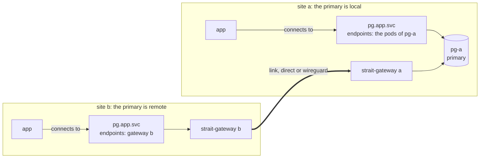
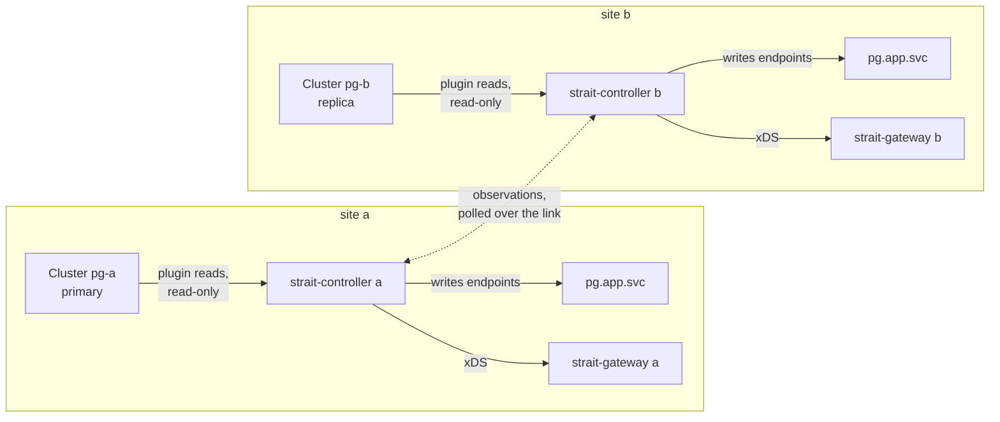

# Introduction

Strait gives an application one stable local name per dependency, at every site, and points that name at the member that is active now. A site is one Kubernetes cluster. The member can run at the same site or at another one, and Strait carries the TCP traffic between sites.

The application holds no topology: no host lists, no address maps, no failover logic. It connects to `pg.app.svc:5432` at every site. When the PostgreSQL primary moves to another site, the name follows.

Strait routes. It never fails over, promotes or demotes a workload. The workload's own controller, such as CloudNativePG, or the operator moves the primary, and Strait follows.

## How it works

The same `SiteService`, named `pg`, is applied at both sites. Each site decides its own route. A connection to `pg.app.svc` takes this path:



- At site a, the primary `pg-a` is local. `pg.app.svc` points at its pods.
- At site b, the primary is remote. `pg.app.svc` points at gateway b, which carries each connection over the link to gateway a, and on to `pg-a`.

The route comes from the controller at each site:



Each controller reads only the members at its own site. It polls the other site's observations through the gateways, over the same link. The pieces, the resources and what each one guarantees are in [Concepts](./concepts.md).

## What it looks like

`strait explain` at site b, while the primary runs at site a:

```
$ strait --context site-b explain pg -n app
SiteService:  app/pg
Mode:         Single
Plugin:       cnpg, role primary
Policy:       multiple RouteNowhere, unknownHold 30s
Route:        pg-a
Reason:       Active
Meaning:      Single mode. Exactly one member is writable, and no known site declares another. The name points at it.
Message:      pg-a is the only writable member
Since:        2026-10-27T09:48:00Z (12m ago)
Endpoints:    1

Members:
NAME  SITE  ROUTED  PATH     ROLE     ELIGIBLE  STATE   REASON          OBSERVED  CONFIRMED
pg-a  a     true    Gateway  primary  true      Stable  PrimaryCluster  1s        1s
pg-b  b     false   -        replica  false     Stable  ReplicaCluster  1s        -

Declarations:
SITE  PRIMARY
a     pg-a
b     pg-a

Conditions:
TYPE                  STATUS  REASON                  SINCE  MESSAGE
Routed                True    Active                  12m    pg-a is the only writable member
Multiple              False   NoMultipleWritable      12m    -
DeclarationsDisagree  False   NoDeclarationsDisagree  12m    -
Held                  False   NoHeldUnknown           12m    -
Applied               True    Synced                  12m    -
DeclarationUnmatched  False   NoDeclarationUnmatched  12m    -
```

Every command of `strait` is in [The strait command](../reference/cli.md).

## Try it on kind

`make e2e` builds two sites on kind, with CloudNativePG in its distributed topology, and runs every scenario: link failover, switchover, a partition, disagreeing declarations, site loss, and two writable members.

```sh
make e2e
```

It builds the image, creates the kind clusters `strait-e2e-a` and `strait-e2e-b`, runs the scenarios, and deletes the clusters. To keep them and look around:

```sh
STRAIT_E2E_KEEP=1 make e2e
make build
bin/strait --kubeconfig <kubeconfig of site b> --context kind-strait-e2e-b -n db explain pg
```

The test prints where it wrote the kubeconfigs. The prerequisites, the fixture and the scenarios are in [`test/e2e/README.md`](../../test/e2e/README.md).

To set up two real clusters, start with [Install](./install.md), then [Getting started](../getting-started.md).
